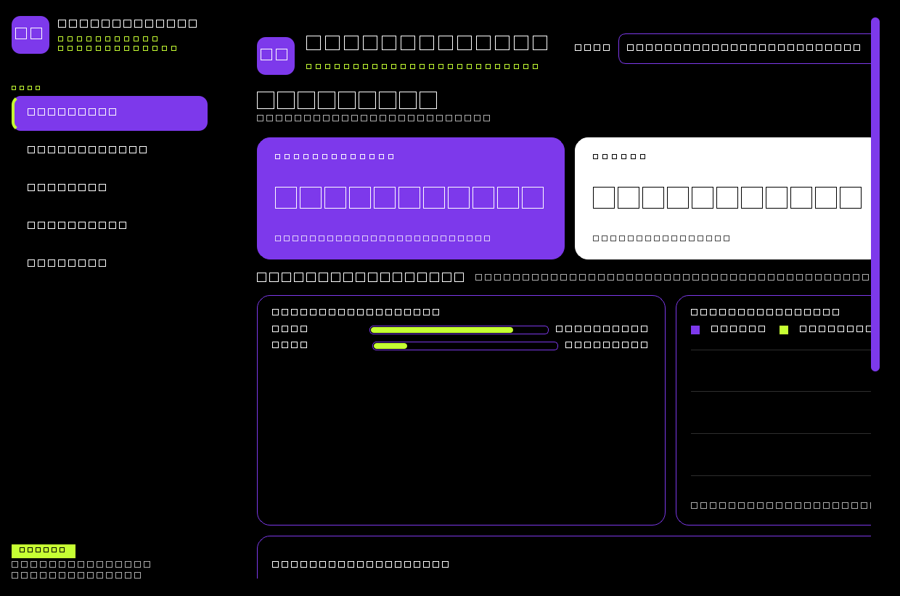
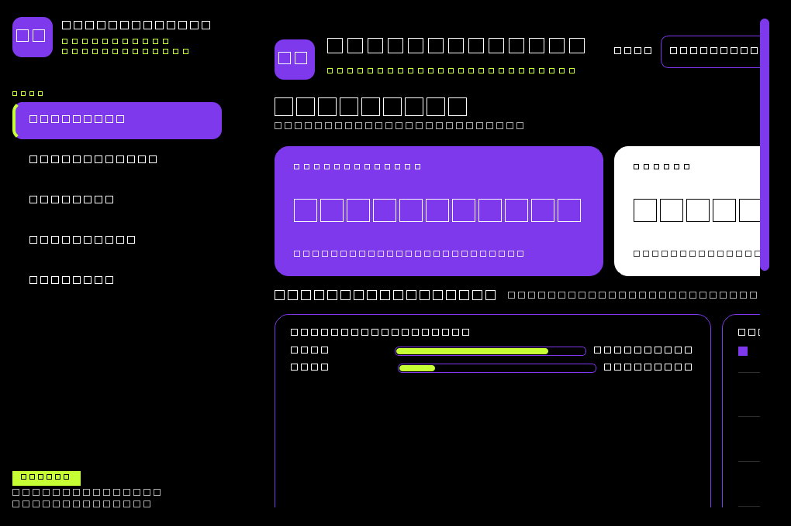
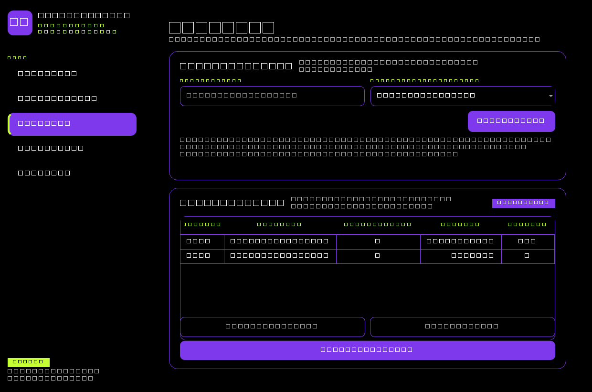
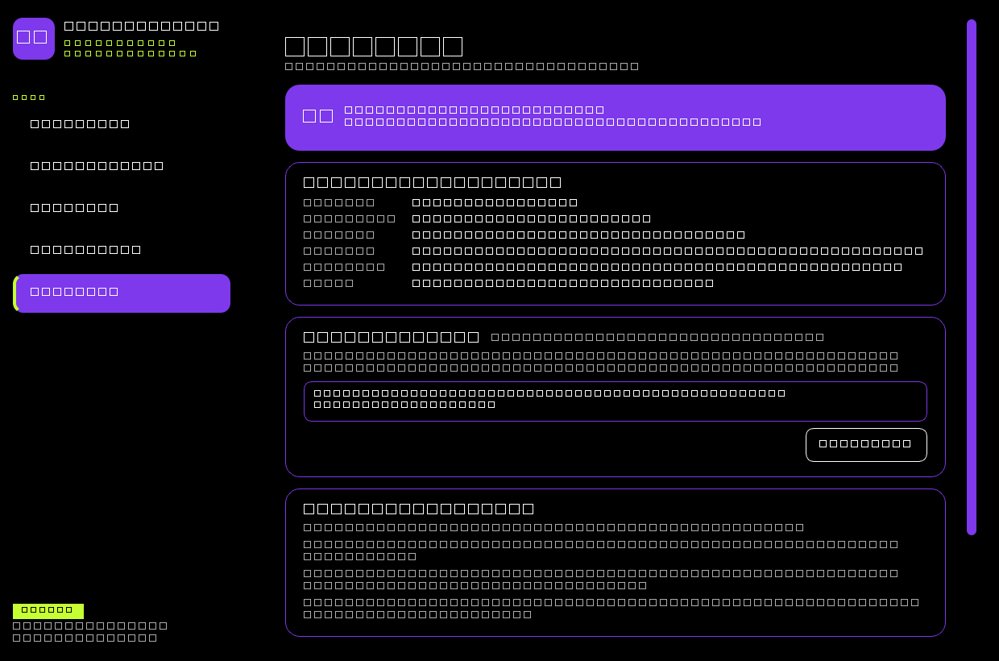
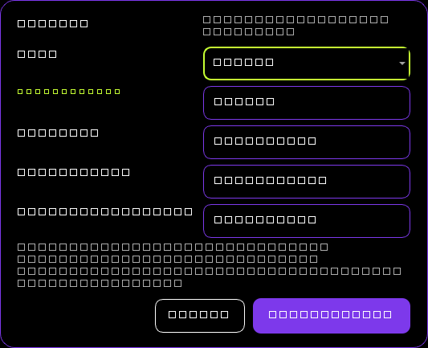
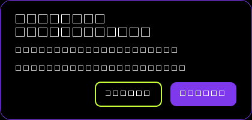

# Pocket Ledger

A small, private personal finance tracker built with Python, **PySide6 (Qt for
Python)** and SQLite. It runs entirely on your own computer — there are no
accounts, no bank connections and no data leaves your machine.

The original Streamlit web interface has been removed. There is one native
desktop application, `desktop_app.py`, plus reproducible Windows x64 release
artifacts built from it.

## Features

- Automatically creates a local SQLite database on first run.
- Multi-account support: create, rename, set default, and delete empty accounts.
- Per-account currency (ISO 4217 code + precision 0/2/3). Account currency is fixed after creation.
- Add income and expense transactions with account, amount, category, description and date.
- View transactions in a fast, sortable, filterable table with account/currency display.
- Edit or delete a transaction (delete asks for confirmation first).
- Dashboard shows database-backed headline cards (total balance, monthly income, expenses, net savings), spending-by-category bars, monthly income/expense charts, recent transactions and per-account balances.
- Dashboard figures are scoped to one currency (or one account) at a time; different currencies are never added together.
- Import bank statements from CSV into a selected account, with reviewable preview, duplicate detection scoped to account, and currency-aware totals.
- Strict amount validation: amount must be greater than zero and respect the selected account's currency precision; amounts are stored as integer minor units (no floating-point financial math).
- Manual add/edit amounts accept grouping commas such as `31,417.00` and `1,23,456.78`; CSV import keeps its own parsing rules.
- Dashboard, transactions and account balances refresh after add/edit/delete, account changes and navigation back to a cached page.
- Violet / lime / black / white brand design system throughout. Private local data only.
- Windows title bar, taskbar and installer use the supplied `icons/PC.ico`; `icons/Mobile.svg` is reserved for future Phase 5 branding only.

## Phase 3 stabilization — final

The Phase 3 work stabilized the completed Qt redesign without changing the
palette or database schema:

- grouped manual amounts are normalised only at the Add/Edit boundary, so CSV
  import behaviour is unchanged;
- integer minor units, 0/2/3 decimal precision, invalid-number checks and
  excess-decimal rejection are preserved;
- one app-level invalidation path refreshes cached pages after add, edit,
  delete, account changes, date-period changes and navigation;
- cards, dialogs, dropdowns, tables and buttons use only
  `#000000`, `#7D39EB`, `#C6FF33` and `#FFFFFF`, with no gradients or shadows;
- Settings is scrollable and shows app version, active data path, local-only
  privacy, limitations and clearly labelled future Phase 5/Phase 6 plans.

Verification at the end of Phase 3 was **216 passed**. The current full suite,
including the new Windows release-path tests, is **220 passed in 38.00s**.
Offscreen GUI smoke tests used isolated temporary databases and produced the
screenshots linked below. The test suite uses per-test and session-level
fingerprints so it cannot write to the live database or its WAL sidecars.

## Icon assets and previews

The supplied artwork is used as-is; no icon was redesigned.

| Asset | Purpose | Status |
| --- | --- | --- |
| `icons/PC.svg` | Supplied desktop artwork (Option 2) | Unchanged source |
| `icons/PC.ico` | Multi-size Windows icon rendered from `PC.svg` | Bundled in the EXE, title bar, taskbar and installer |
| `icons/Mobile.svg` | Supplied mobile artwork (Option 3) | Untouched; reserved for Phase 5 Android |

| PC icon (desktop / taskbar) | Mobile icon (future Android) |
| --- | --- |
|  |  |

The preview PNGs in `docs/icons/` are rendered documentation images only; the
source SVGs and the generated ICO remain the branding assets.

## Screenshots

Captured offscreen from the redesigned app with an isolated test database.

| Dashboard (1240×820) | Dashboard (1020×680 minimum) |
| --- | --- |
|  |  |

| Transactions | Accounts |
| --- | --- |
|  |  |

| Settings (1240×820) | Settings (1020×680 minimum) |
| --- | --- |
|  |  |

| Edit transaction | Delete confirmation |
| --- | --- |
|  |  |

CSV import preview:


## Project structure

```text
pocket-ledger/
├── desktop_app.py          # Application entry point (window + sidebar)
├── database.py             # Public data functions (all SQL lives here)
├── migrations.py           # Versioned, transactional schema upgrades
├── version.py              # Single source of truth for vX.Y.Z
├── release_paths.py        # Frozen-build data location rules
├── PocketLedger.spec       # PyInstaller onedir build spec
├── requirements.txt        # Runtime and test packages
├── requirements-build.txt  # Windows release build tool versions
├── importers/              # CSV import logic (no GUI, standard library only)
│   ├── __init__.py
│   ├── csv_parser.py       # Encoding, mapping, dates and money parsing
│   ├── dedupe.py           # Import hashes and duplicate classification
│   ├── service.py          # Preview, edits and atomic commit
│   └── rules.json          # Editable keyword -> category rules
├── icons/
│   ├── PC.svg              # Supplied desktop icon source (unchanged)
│   ├── PC.ico              # Windows title/taskbar icon rendered from PC.svg
│   └── Mobile.svg          # Supplied mobile icon, reserved for Phase 5
├── installer/
│   └── PocketLedger.iss    # Inno Setup script (per-user installer)
├── scripts/
│   ├── build_windows_release.ps1    # Build ZIP + EXE + checksums + notes
│   └── verify_windows_release.ps1   # Portable/install/upgrade/uninstall checks
├── docs/
│   ├── icons/              # Icon previews for this README
│   ├── screenshots/        # Redesigned app screenshots for this README
│   ├── release_notes_template.md    # GitHub Release notes template
│   └── db_recovery_plan.md
├── README.md
├── .gitignore
├── data/
│   ├── pocket_ledger.db    # Source-run database; created automatically
│   └── backups/            # Automatic copies made before a migration
├── sync/                   # Local-first building blocks (no network yet)
│   ├── __init__.py
│   ├── identity.py
│   └── store.py
├── tests/
│   ├── conftest.py         # Temp DB fixtures + live DB protection + offscreen Qt
│   ├── test_apps_smoke.py
│   ├── test_brand_ui.py
│   ├── test_phase3_stabilization.py
│   ├── test_release_paths.py
│   └── ...                 # Money, database, migration, CSV and model tests
├── ui/                     # PySide6 screens (thin; no SQL)
│   ├── theme.py            # Brand palette, stylesheet and shared widgets
│   ├── models.py           # Table models and proxies
│   ├── workers.py          # QThread wrapper for database calls
│   ├── dashboard.py
│   ├── transactions.py
│   ├── accounts.py
│   ├── import_csv.py
│   └── settings.py
└── utils/
    ├── calculations.py     # Legacy INR helper (deprecated for new UI paths)
    ├── currencies.py
    ├── formatting.py
    └── money.py
```

## Setup (source run)

Open PowerShell in the project folder. Python 3.15 was used for the v0.4.0
release build.

```powershell
cd E:\projects\pocket-ledger
python -m venv .venv
.\.venv\Scripts\python.exe -m pip install -r requirements.txt
.\.venv\Scripts\python.exe desktop_app.py
```

If PowerShell blocks a command, use `.\.venv\Scripts\python.exe` directly or
allow scripts for this terminal only:

```powershell
Set-ExecutionPolicy -Scope Process -ExecutionPolicy Bypass
```

A native window opens with the supplied PC icon in the title bar and taskbar,
a violet **PL** brand mark, the `YOUR MONEY. YOUR CONTROL.` tagline and a
sidebar: **Dashboard**, **Transactions**, **Accounts**, **Import CSV** and
**Settings**. Close the window (or press `Alt+F4`) to quit.

### Safe development databases

Tests and development runs should never use the real database. Set
`POCKET_LEDGER_DB` to a separate SQLite file before starting Python:

```powershell
$env:POCKET_LEDGER_DB = "$env:TEMP\pocket-ledger-dev.db"
.\.venv\Scripts\python.exe desktop_app.py
```

The desktop window shows a **DEV DB** badge whenever the active path is not the
production path for that build. Source runs use `data/pocket_ledger.db`;
packaged builds use the data location described below. Settings always shows
the active path.

`database.py` also refuses to open the source-tree live database when
`POCKET_LEDGER_TEST_MODE` is enabled. Pytest enables this automatically and
points every test at a temporary database before any initialization runs.

## Windows release (v0.4.0)

### Artifacts

A successful build writes these files to `build\windows-release\artifacts\`
(this directory is gitignored):

- `PocketLedger-v0.4.0-win64-portable.zip` — extract anywhere and run
  `PocketLedger.exe`; no installation or admin rights required.
- `PocketLedger-v0.4.0-win64-setup.exe` — per-user Windows installer with
  directory selection, Start Menu shortcut, optional desktop shortcut, stable
  AppId for upgrades and an Apps & Features uninstall entry.
- `SHA256SUMS.txt` — SHA-256 hashes for both artifacts.
- `RELEASE_NOTES.md` — generated release notes for that version.

### Build locally

```powershell
.\.venv\Scripts\python.exe -m pip install -r requirements.txt -r requirements-build.txt
winget install --id JRSoftware.InnoSetup -e
powershell.exe -NoProfile -ExecutionPolicy Bypass -File .\scripts\build_windows_release.ps1
powershell.exe -NoProfile -ExecutionPolicy Bypass -File .\scripts\verify_windows_release.ps1
```

`build_windows_release.ps1` reads the version from `version.py`, builds with
`PocketLedger.spec`, embeds `icons/PC.ico`, creates a clean portable staging
folder with `portable.marker`, compiles the Inno Setup installer and writes the
checksums and notes. Use `-Version X.Y.Z` to build another semantic version.

`verify_windows_release.ps1` checks the checksums, extracts the ZIP into a
clean folder, runs the portable EXE, performs a clean install, upgrades over
that install, verifies the Apps & Features entry, uninstalls, and confirms user
data survives the upgrade and uninstall.

### Data locations and preservation

| Build | Database location | Install directory contains user data? |
| --- | --- | --- |
| Source run | `data\pocket_ledger.db` beside the code | n/a |
| Portable ZIP | `data\` beside the extracted `PocketLedger.exe` | Yes, by design; keep the whole folder |
| Installed EXE | `%LOCALAPPDATA%\Pocket Ledger\data\pocket_ledger.db` | **No** |

The installer never copies an existing database into its own directory and has
no `UninstallDelete` entries. Upgrades reuse the same AppId and replace only
program files. Uninstall removes the program directory and shortcuts but leaves
`%LOCALAPPDATA%\Pocket Ledger\data` untouched. An explicit
`POCKET_LEDGER_DB` environment variable still overrides the default path.

### GitHub Release preparation

`docs/release_notes_template.md` is the GitHub Release notes template. It
includes highlights, upgrade notes and PowerShell checksum verification
instructions. The build script substitutes the current version and writes the
generated copy beside the artifacts. Publishing a release, tagging and pushing
are intentionally separate manual steps; no remote release is created by the
build script.

## Screens and workflows

- **Dashboard** — choose a currency/account scope and a date range (this month, last month, last 3 months, this year, all time or a custom range). The headline cards, category bars, monthly activity chart and recent transactions are all calculated from the local database. Account-wise cards always keep their own currency; no cross-currency totals. First-run prompt when only the untouched default INR account exists with no transactions.
- **Transactions** — select account, add income/expenses with strict currency-precision validation (grouping commas are accepted), browse/sort/filter table, filter by account or all accounts, edit a selected row (or double-click it), and delete with confirmation.
- **Accounts** — create (name + searchable currency), rename, make default, delete. Currency is read-only after creation; deletion is blocked for accounts with live transactions or when it is the only remaining account.
- **Import CSV** — select destination account, review and import a bank statement; duplicate detection is scoped to the selected account. See below.
- **Settings** — brand information, active database location, local-only privacy, known limitations, and clearly labelled future planning for Phase 5 Android and Phase 6 Wi-Fi Sync (not implemented).

## Importing a CSV

The **Import CSV** entry in the sidebar handles statements you downloaded from
your bank — nothing is uploaded anywhere.

1. Choose the destination **account**. Amounts are interpreted using that account's currency and decimal precision, and duplicate detection is scoped to that account.
2. Choose the `.csv` file. The importer detects the encoding (UTF-8 or Windows-1252), the separator (comma, semicolon or tab), the real header row and the date format.
3. Check the column mapping. Date, description, amount (or separate debit/credit), balance and reference are pre-filled and can be changed.
4. Review the table. Rows can be included or excluded, and their date, description, category and amount can be edited inline. Duplicate rows are excluded by default; tick one to force-include it. Warning and error rows show a reason instead of crashing the import.
5. Click **Import**. All included rows are saved in one all-or-nothing database transaction: they get UUIDs, timestamps, change-log entries and account-scoped import hashes just like manually added transactions. A result summary is shown afterwards.

Supported value formats include `DD/MM/YYYY`, `DD-Mon-YYYY`, `YYYY-MM-DD`, Indian number grouping (`1,23,456.78`), currency symbols, `(123.45)` parentheses for negatives, and `Dr`/`Cr` suffixes. Amounts are parsed with `Decimal`; no extra third-party package is needed.

Duplicate detection uses a SHA-256 hash of the normalised date, signed amount in the account's minor units and description, plus an occurrence index so two genuinely identical same-day purchases are both kept. Re-importing the same file into the same account creates zero new transactions. A soft-deleted match is flagged as **WAS DELETED**.

Automatic categories come from the editable `importers/rules.json` file. Add keywords or change `default_category` there; no code change is needed.

## How it works

1. The app calls `initialize_database()` at startup.
2. `database.py` opens the file, then `migrations.py` reads
   `PRAGMA user_version`. If the file is old, it makes a timestamped backup and
   runs each pending step inside its own transaction. An up-to-date database
   only pays for one cheap version check.
3. The form collects a transaction. `add_transaction()` validates the values
   and inserts them using a parameterized query (`?` placeholders), which keeps
   the database safe from malformed input. The same transaction also gets a
   UUID, timestamps, revision 1 and an `insert` entry in the change log.
4. `get_all_transactions()` reads live rows (tombstones are hidden); the Qt
   model supplies display values to the table.
5. Deleting marks the row with `deleted_at_ms` instead of removing it, then
   appends a `delete` entry to the change log. That is what lets a future phone
   learn about the deletion.
6. `update_transaction()` edits only the fields you pass, increases the
   revision and appends an `update` entry.

The Qt model/view design replaced an older widget-per-row interface. The old
CustomTkinter list built roughly 20 live widgets per row (~100,000 widgets for
5,000 transactions) and rebuilt them on every tab switch: about 154 seconds to
render and 64 seconds per switch. Qt paints only visible rows.

## Database details

Current schema version is **4** (`PRAGMA user_version = 4`).

Key transaction fields:

| Column | Type | Notes |
| --- | --- | --- |
| `id` | INTEGER | Local primary key |
| `uuid` | TEXT | Stable global id |
| `transaction_type` | TEXT | `income` or `expense` |
| `amount_minor` | INTEGER | Signed magnitude stored as integer minor units; displayed per account currency |
| `amount` | REAL | Legacy compatibility field kept by migrations/data layer |
| `account_uuid` | TEXT | Owning account |
| `category` | TEXT | Required |
| `description` | TEXT | Optional |
| `transaction_date` | TEXT | `YYYY-MM-DD` |
| `created_at_ms` / `updated_at_ms` | INTEGER | UTC milliseconds |
| `deleted_at_ms` | INTEGER | `NULL` means live |
| `revision` | INTEGER | Incremented on edits |
| `import_hash` | TEXT | Duplicate marker, unique per live account+hash |

Accounts table stores name, currency code, precision, default flag, timestamps, soft delete and sync metadata.

Supporting tables: `app_meta`, `devices`, `sync_changes`, `sync_peers`, `sync_conflicts`, `import_batches`.

The database uses **WAL** mode and a five-second busy timeout. Automatic pre-migration backups are written before schema upgrades.

## Your data

- Source runs store everything in `data/pocket_ledger.db`.
- Installed builds store everything in `%LOCALAPPDATA%\Pocket Ledger\data`.
- Portable builds store everything in `data\` beside `PocketLedger.exe`.
- Before a migration, an automatic copy is written to the active `data/backups/`.
- SQLite may create `pocket_ledger.db-wal` and `pocket_ledger.db-shm` while the
  app is running. These are normal WAL files; close the app before copying the
  database by hand.
- `.gitignore` excludes database files and backups, so personal data is never
  committed.
- To start over, close the app and delete the active database file. An empty
  database is recreated automatically. The installer and uninstaller never do
  this for you.

## Run the tests

```powershell
.\.venv\Scripts\python.exe -m pytest -q
```

Current result: **220 passed in 38.00s**.

The suite never writes to the live database. A central connection guard refuses
live connections in test mode, every test uses a temporary `POCKET_LEDGER_DB`,
and per-test plus session-level fingerprints cover the live file and its
WAL/SHM/journal sidecars. Migration tests copy the live file through SQLite's
read-only backup API. Qt tests run offscreen (`QT_QPA_PLATFORM=offscreen`).
Coverage includes:

- migrating a copy of the real database and preserving every row;
- UUIDs, timestamps, schema version, indexes and the change log;
- running migrations twice, and rolling back a deliberately broken step;
- add, view, update, soft delete and import-hash duplicates;
- CSV parsing, mapping overrides, bad rows, Dr/Cr and Indian number formats;
- same-day duplicates, re-imports, soft-deleted matches and force-including;
- all-or-nothing rollback, change-log entries and import metadata;
- offscreen Qt: main window, table load/sort/filter, add/edit/delete, import
  dialog, table models and background workers;
- brand UI: real dashboard figures, date filters, currency isolation, scrolling
  and button/text sizing at the minimum window size;
- phase 3 stabilization: grouped manual amounts, exact minor-unit conversion,
  comma-safe edit validation, dashboard refresh after add/edit/delete/account
  changes/navigation, desktop icon loading and Settings layout fit;
- Windows release paths: installed data outside program files, portable marker
  behaviour and preservation of explicit `POCKET_LEDGER_DB` overrides;
- formatting helpers moved out of the old Streamlit and Tk screens;
- database path isolation, fail-closed live connection checks, worker cleanup
  and live-database fingerprint coverage.

## Troubleshooting

- **Window does not open from source**: reinstall dependencies with
  `.\.venv\Scripts\python.exe -m pip install -r requirements.txt` and run
  `.\.venv\Scripts\python.exe desktop_app.py` from the project folder.
- **Qt platform error in a headless shell**: set
  `$env:QT_QPA_PLATFORM = "offscreen"` before running, or just run the tests,
  which set it automatically.
- **Portable table looks empty**: check the filter box and look for
  `data\pocket_ledger.db` beside `PocketLedger.exe`.
- **Installed app cannot find old data**: Settings shows the active path. It
  should be `%LOCALAPPDATA%\Pocket Ledger\data\pocket_ledger.db` unless you set
  `POCKET_LEDGER_DB` yourself.
- **Windows blocks the installer**: the v0.4.0 build is not code-signed. Check
  the SHA-256 hash against `SHA256SUMS.txt` before allowing it.

## Known limitations / not included yet

- Windows x64 artifacts are provided; there are no macOS/Linux installers.
- No auto-update service and no code signing; download and verify each release manually.
- No PDF statement import (text/OCR), no bank connections, no cloud sync/UI sync, no mobile app. Phase 5 Android and Phase 6 Wi-Fi Sync are future planning only; the supplied mobile SVG is kept unchanged for that work.
- No budgets, forecasts or backup/restore UI (the data file is local and can be copied manually while the app is closed).
- Account currency is immutable after creation by design; create a new account for a different currency.
- Amounts are integer minor units; supported currency precisions are 0/2/3 decimal places.
- The UI uses the fixed violet / lime / black / white brand palette; no theme switcher.
- Legacy `amount` REAL field remains for compatibility; UI and new logic use `amount_minor` + currency.
