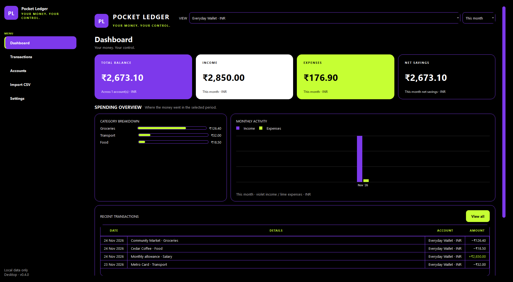
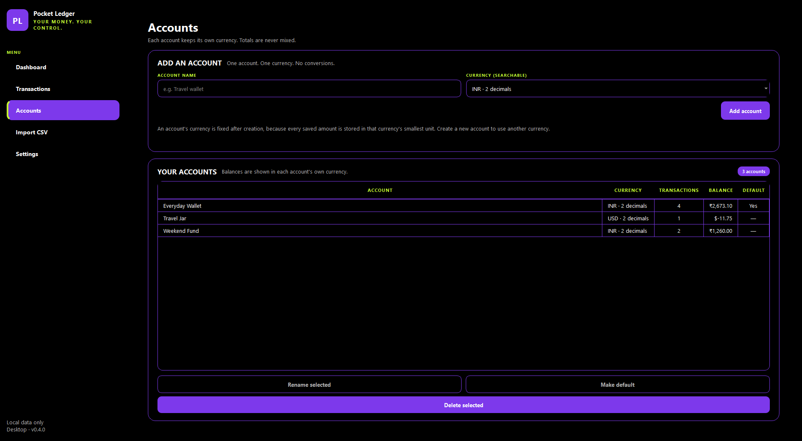
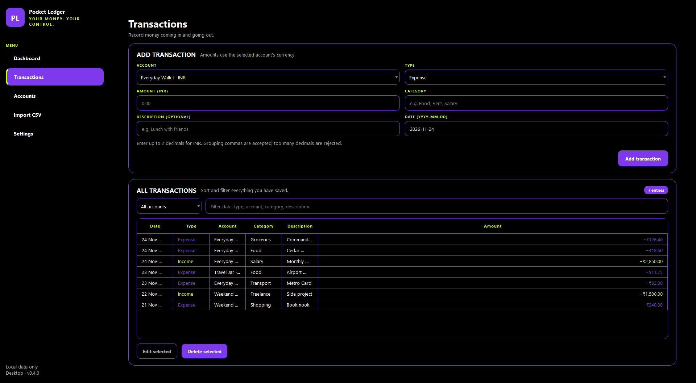
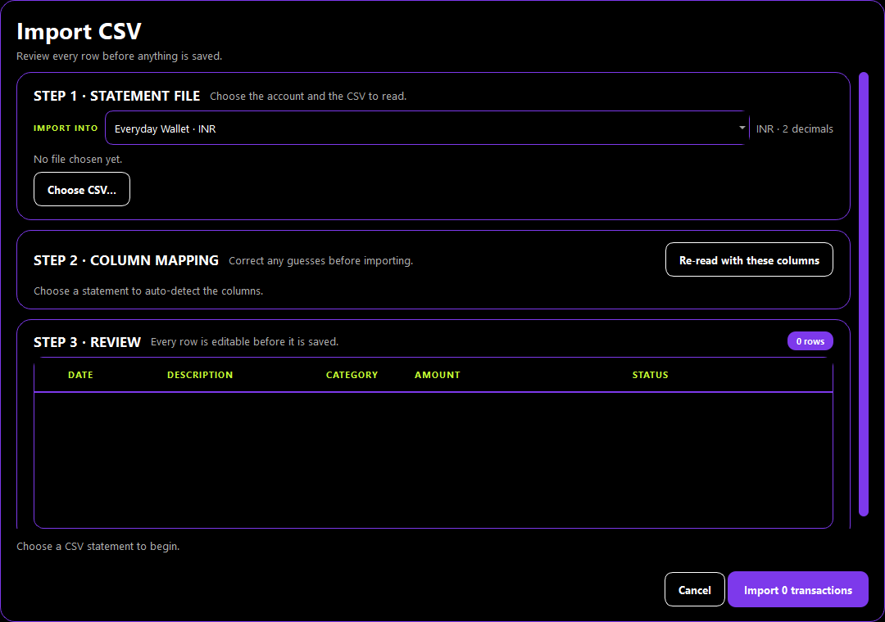
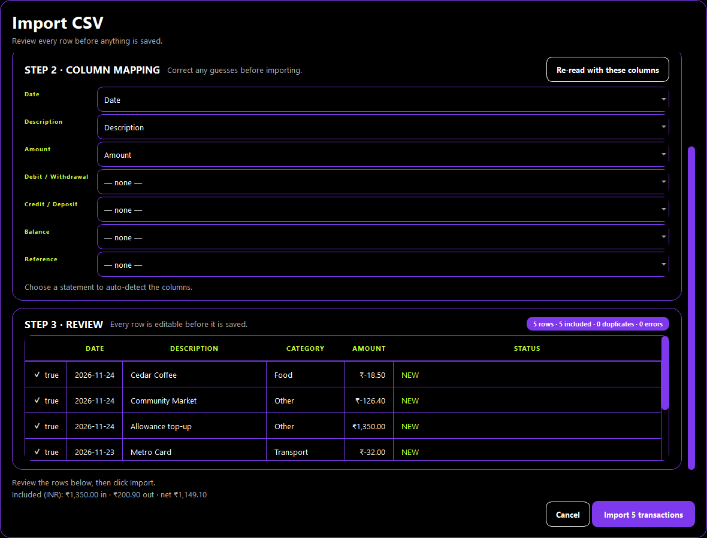
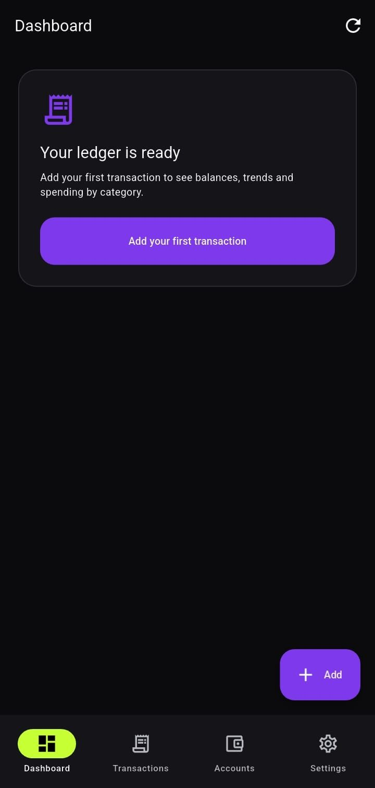
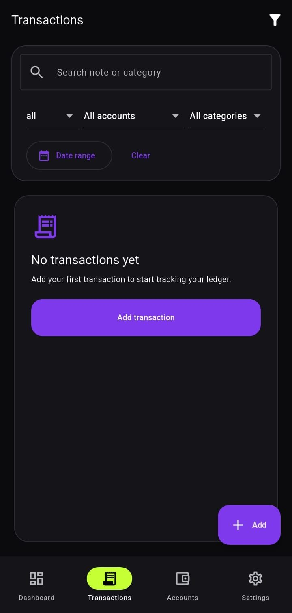
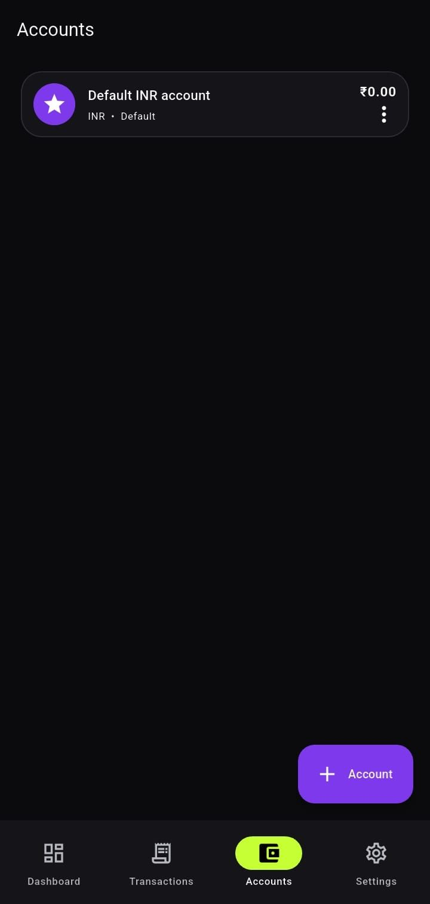
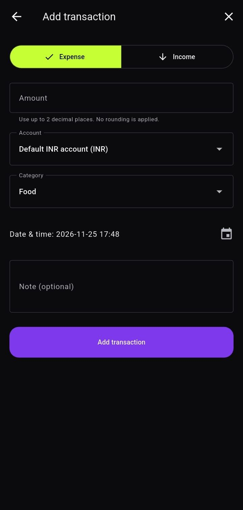
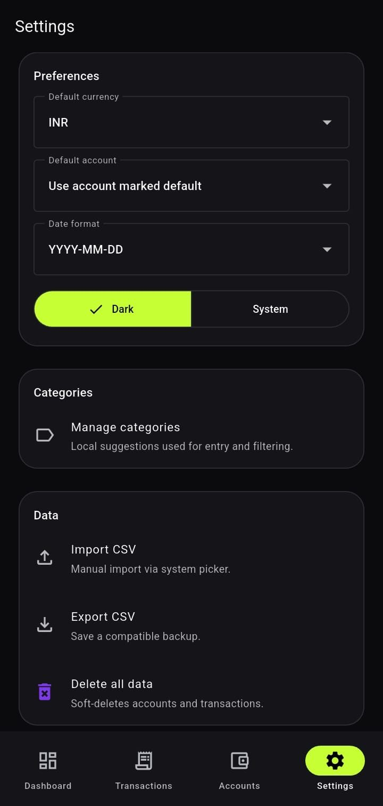

<h3 align="center">A simple personal finance tracker that keeps your data on your own computer</h3>

<p align="center">
  
</p>
<p align="center">Your accounts, income and spending at a glance.</p>

## Overview

* **Private by default.** Your money data stays on your computer. No account, no cloud.
* **Import your bank statements.** Bring in your transactions and review them before saving.
* **See where your money goes.** Keep track of your accounts and spending in one place.
* **Simple to use.** Clean and easy, with no setup headaches.

## Screenshots

<p align="center">
  
</p>
<p align="center">See every account and its balance in one place.</p>

<p align="center">
  
</p>
<p align="center">Browse your money in and money out, all on one list.</p>

<p align="center">
  
</p>
<p align="center">Bring in your bank statement.</p>

<p align="center">
  
</p>
<p align="center">Check everything before it's saved.</p>

## Android app

The same private ledger on your phone. Works offline, with no account, no network and no tracking.

<p align="center">
  
  
  
  
  
</p>

<p align="center">Your balance, spending and trends at a glance.</p>
<p align="center">Every transaction in one list.</p>
<p align="center">All your accounts and balances.</p>
<p align="center">Add a transaction in seconds.</p>
<p align="center">Settings and your data, all on your phone.</p>

```bash
cd mobile
flutter build apk --release --split-per-abi
```

## License

This project is licensed under the [MIT License](LICENSE).

Copyright (c) 2026 iluvpercs.
