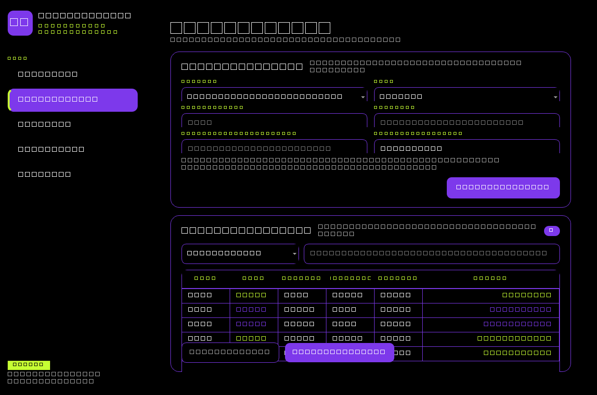
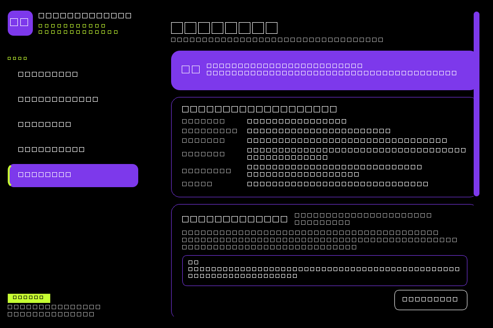
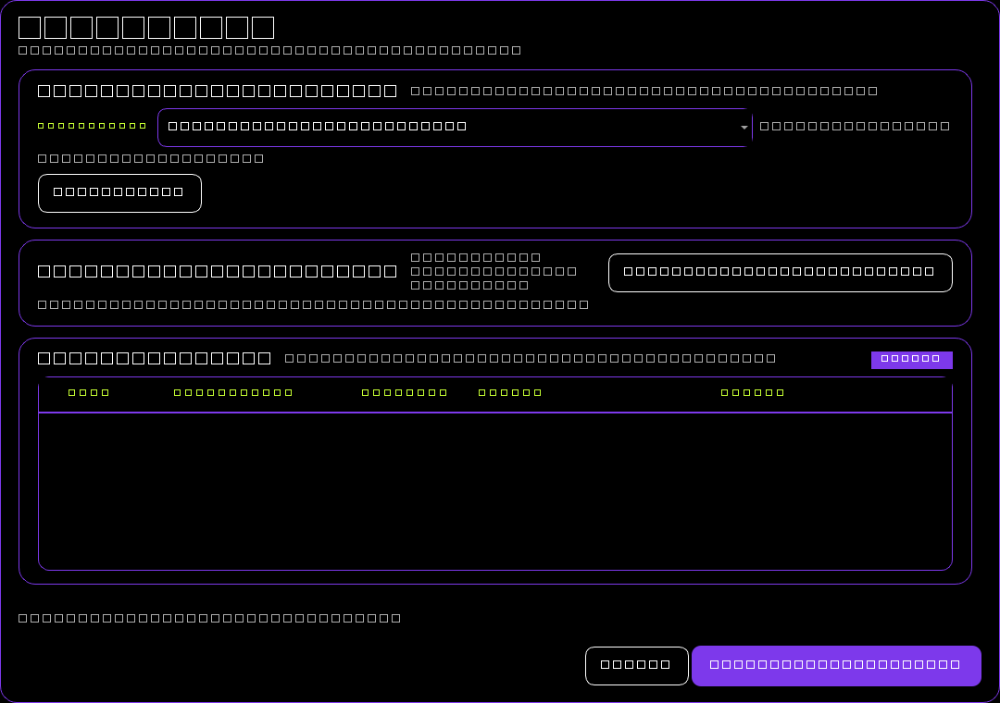

# Pocket Ledger

Pocket Ledger is a private, local-only personal finance tracker built with Python, **PySide6 (Qt for Python)** and SQLite. It runs entirely on your own computer: no accounts, no bank connections and no data leaves your machine. Windows x64 builds are available as a portable ZIP and an installer.

## Features

- Automatically creates a local SQLite database on first run.
- Multi-account support: create, rename, set default and delete empty accounts.
- Per-account currency with ISO 4217 codes and 0/2/3 decimal precision. Account currency is fixed after creation.
- Add income and expense transactions with account, amount, category, description and date.
- View transactions in a fast, sortable, filterable table with account and currency display.
- Edit or delete a transaction; deletion asks for confirmation first.
- Dashboard with database-backed balance, income, expense and net-savings cards, category bars, monthly charts, recent transactions and per-account balances.
- Dashboard figures are scoped to one currency or one account at a time; different currencies are never added together.
- Import bank statements from CSV with a reviewable preview, account-scoped duplicate detection and currency-aware totals.
- Strict amount validation with integer minor-unit storage and grouping-comma support in manual amounts.
- Dashboard, transactions and account balances refresh after data changes, account changes and navigation back to a cached page.
- Violet / lime / black / white brand design throughout.
- Windows title bar, taskbar and installer use the supplied PC icon; the mobile icon is reserved for the Android app.

## Icon previews

| Desktop | Mobile |
| --- | --- |
|  |  |

## Screenshots

| Dashboard (1240×820) | Dashboard (1020×680 minimum) |
| --- | --- |
|  |  |

| Transactions | Accounts |
| --- | --- |
|  |  |

| Settings (1240×820) | Settings (1020×680 minimum) |
| --- | --- |
|  |  |

| Edit transaction | Delete confirmation |
| --- | --- |
|  |  |

CSV import:



## Installation

### Portable ZIP

1. Download `PocketLedger-v0.4.0-win64-portable.zip`.
2. Extract it anywhere you like.
3. Run `PocketLedger.exe`. No installation or administrator rights are required.

The portable build keeps its database in `data\` beside `PocketLedger.exe`, so keep the whole folder when moving or backing it up.

### Installer EXE

1. Run `PocketLedger-v0.4.0-win64-setup.exe`.
2. Choose the install location, Start Menu folder and optional desktop shortcut.
3. Launch Pocket Ledger from the Start Menu or desktop.

The installer is per-user and adds an Apps & Features entry. Your data is stored outside the install directory and is not removed by uninstalling.

Verify downloads against the SHA-256 hashes in `SHA256SUMS.txt` before running them.

### Run from source

```powershell
cd E:\projects\pocket-ledger
python -m venv .venv
.\.venv\Scripts\python.exe -m pip install -r requirements.txt
.\.venv\Scripts\python.exe desktop_app.py
```

The window shows a **DEV DB** badge when `POCKET_LEDGER_DB` points at a separate database. Settings always shows the active path.

## Screens and workflows

- **Dashboard** — choose a currency/account scope and date range; headline cards, category bars, monthly activity and recent transactions are all calculated from the local database.
- **Transactions** — add, edit, delete, sort and filter transactions, with strict currency-precision validation and comma-friendly amounts.
- **Accounts** — create, rename, set default and delete accounts. Currency is read-only after creation.
- **Import CSV** — select a destination account, review rows and import them with account-scoped duplicate detection.
- **Settings** — brand information, active database location, local-only privacy and known limitations.

## Importing a CSV

1. Choose the destination **account**. Amounts use that account's currency and precision, and duplicates are checked within that account.
2. Choose a `.csv` file. The importer detects the encoding, separator, header row and date format.
3. Check the column mapping. Date, description, amount (or separate debit/credit), balance and reference are pre-filled.
4. Review the table. Rows can be included or excluded, and date, description, category and amount can be edited inline.
5. Click **Import**. Included rows are saved in one all-or-nothing database transaction and a result summary is shown.

Supported value formats include `DD/MM/YYYY`, `DD-Mon-YYYY`, `YYYY-MM-DD`, Indian number grouping (`1,23,456.78`), currency symbols, `(123.45)` for negatives and `Dr`/`Cr` suffixes.

Duplicate detection uses a hash of the normalised date, signed amount and description, with an occurrence index so two genuine same-day purchases are both kept. Re-importing the same file creates no new rows. Categories are driven by the editable `importers/rules.json` file.

## Architecture

- PySide6 Qt UI with cached pages and model/view tables for fast, low-memory lists.
- SQLite storage in WAL mode with a five-second busy timeout.
- Money stored as integer minor units with per-account 0/2/3 decimal precision.
- Automatic timestamped backups before schema migrations.
- Soft deletes and a local change log prepare the data model for future sync.

## Data and privacy

| Build | Database location | User data in install directory? |
| --- | --- | --- |
| Source run | `data\pocket_ledger.db` beside the code | n/a |
| Portable ZIP | `data\` beside the extracted `PocketLedger.exe` | Yes, by design |
| Installed EXE | `%LOCALAPPDATA%\Pocket Ledger\data\pocket_ledger.db` | **No** |

All data stays on the machine. The installer never copies a database into its own directory. Upgrades reuse the same AppId and replace only program files. Uninstall removes the program and shortcuts but leaves `%LOCALAPPDATA%\Pocket Ledger\data` untouched. An explicit `POCKET_LEDGER_DB` environment variable overrides the default path.

SQLite may create `-wal` and `-shm` sidecar files while the app is running. Close the app before copying the database by hand. To start over, close the app and delete the active database file; an empty one is recreated automatically.

## Run the tests

```powershell
.\.venv\Scripts\python.exe -m pytest -q
```

Tests run offscreen against isolated temporary databases, so your data is never touched.

## Roadmap

- Android app
- Local Wi-Fi Sync

## Limitations

- Windows x64 only; no macOS or Linux installers.
- Binaries are unsigned, so Windows SmartScreen may warn on first run; verify the SHA-256 checksums before allowing them.
- No auto-updater; download and install new releases manually.

## Troubleshooting

- **Window does not open**: reinstall dependencies and run `desktop_app.py` from the project folder.
- **Portable table looks empty**: clear the filter and check for `data\pocket_ledger.db` beside `PocketLedger.exe`.
- **Installed app cannot find old data**: check the active path in Settings; it should be `%LOCALAPPDATA%\Pocket Ledger\data\pocket_ledger.db` unless you set `POCKET_LEDGER_DB` yourself.
